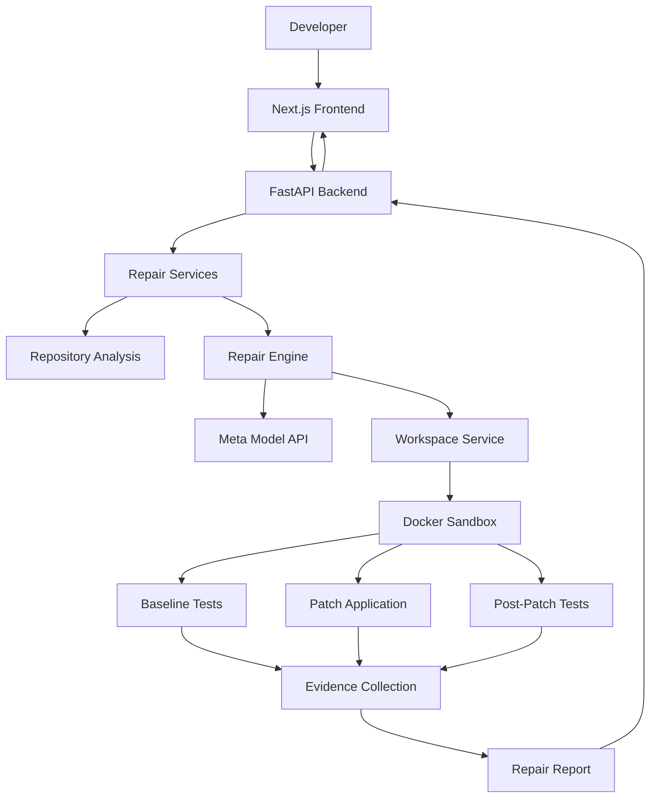

# ProofLoop

**An evidence-driven AI code repair agent that doesn't just suggest fixes — it executes tests and shows you what it fixed.**

ProofLoop investigates Python bugs, generates code patches using Meta's Model API, executes tests inside an isolated Docker environment, and produces evidence-backed repair reports.

A repair is only marked **Verified** when the required execution evidence supports the result.

> Don't just trust the fix. Prove it.

---

## The Problem

AI coding assistants can generate plausible code fixes, but generating a patch does not prove that a bug has been fixed.

Developers still need to:

- Reproduce the original failure.
- Understand the affected code.
- Apply and inspect a patch.
- Run regression tests.
- Confirm that the original failure is resolved.
- Review evidence before trusting the result.

ProofLoop brings these steps together in a controlled, evidence-driven repair workflow.

## What ProofLoop Does

1. **Accepts a bug report** — Submit a bug description or upload a Python repository.
2. **Analyzes the repository** — Examines available source files and test context.
3. **Investigates the issue** — Uses Meta's Model API to help identify the cause and propose a fix.
4. **Reproduces the failure** — Executes baseline tests before applying the patch.
5. **Applies the patch** — Modifies the relevant source code in the isolated workspace.
6. **Runs regression tests** — Executes tests again after the patch.
7. **Collects evidence** — Records execution results, patch information, and integrity information.
8. **Reports the outcome** — Presents the repair status and supporting evidence.

## Key Features

- **AI-assisted bug investigation** using Meta's Model API.
- **Repository ZIP uploads** for analyzing Python projects.
- **Automated patch generation** based on bug reports and repository context.
- **Baseline failure reproduction** before patch application.
- **Docker-based test execution** with isolation and resource restrictions.
- **Post-patch regression testing** to evaluate proposed fixes.
- **Evidence-backed repair reports** with execution and patch information.
- **Repair history** for reviewing previous jobs.
- **Repair Assistant** for asking questions about completed repairs and their evidence.

## Core Principles

| Principle | Description |
|---|---|
| Evidence before verification | A generated patch alone is never sufficient to mark a repair verified. |
| Reproducibility | The original failure should be reproduced before claiming it was fixed. |
| Isolation | Repository code is executed inside a restricted Docker environment. |
| Traceability | Repair reports retain execution results and patch information. |
| Integrity | Reports undergo integrity validation. |
| Honest verification | Verification is limited to the evidence and tests actually executed. |

---

## Architecture



### Main Components

- **Frontend:** Provides the repair workspace, repository upload, repair sessions, history, evidence views, and Repair Assistant.
- **Backend API:** Handles requests, validation, job management, and report retrieval.
- **Repository Analysis:** Examines uploaded repository source and test files.
- **Repair Engine:** Coordinates investigation, patch generation, execution, and evidence collection.
- **Meta Model API:** Supports AI-assisted investigation and patch generation.
- **Docker Sandbox:** Executes baseline and post-patch tests in a restricted environment.
- **Evidence and Reporting:** Collects execution information and determines the resulting repair status.

## Technology Stack

| Layer | Technology |
|---|---|
| Frontend | Next.js, React, TypeScript |
| Styling | Tailwind CSS |
| Backend | Python, FastAPI |
| AI Integration | Meta Model API |
| Execution Isolation | Docker |
| Testing | Pytest |
| API Communication | REST |
| Data Validation | Pydantic |

## Project Structure

```text
proofLoop/
├── backend/
│   ├── app/
│   │   ├── agent/
│   │   ├── schemas/
│   │   ├── services/
│   │   └── main.py
│   ├── sandbox/
│   │   └── Dockerfile
│   ├── scripts/
│   │   └── setup_sandbox.py
│   ├── tests/
│   └── requirements.txt
│
├── frontend/
│   ├── src/
│   │   ├── app/
│   │   ├── components/
│   │   └── lib/
│   └── package.json
│
├── demo-projects/
│   ├── 01-discount-calculator/
│   ├── 02-username-normalizer/
│   ├── 03-pagination/
│   └── 04-password-validator/
│
├── docs/
│   ├── architecture.md
│   └── repair-lifecycle.md
│
├── fixtures/
├── artifacts/
├── .env.example
├── README.md
└── LICENSE
```

---

# Getting Started

You can run ProofLoop locally without depending on the hosted application.

The local installation uses:

- Your own Meta Model API key.
- A locally running FastAPI backend.
- A locally running Next.js frontend.
- Docker for isolated test execution.

**No local demo access code, invitation, or workspace activation is required.**

## Prerequisites

Install the following before proceeding:

| Requirement | Purpose |
|---|---|
| Python 3.11 or later | Backend runtime |
| Node.js and npm | Frontend runtime |
| Docker Desktop or Docker Engine | Isolated repair execution |
| Git | Repository cloning |
| Meta Model API key | AI-assisted investigation and patch generation |

Make sure Docker Desktop or Docker Engine is installed and running before executing repair workflows.

## 1. Clone the Repository

```bash
git clone https://github.com/WizKnight/proofLoop.git

cd proofLoop
```

## 2. Configure the Backend

Create a Python virtual environment from the repository root.

### Windows PowerShell

```powershell
python -m venv .venv

.\.venv\Scripts\Activate.ps1
```

If PowerShell prevents activation, you can use:

```powershell
.\.venv\Scripts\activate.bat
```

### Linux / macOS

```bash
python3 -m venv .venv

source .venv/bin/activate
```

### Install Dependencies

From the repository root:

```bash
python -m pip install --upgrade pip

pip install -r backend/requirements.txt
```

### Configure Environment Variables

Create your local environment file.

**Windows PowerShell:**

```powershell
Copy-Item .env.example .env
```

**Linux / macOS:**

```bash
cp .env.example .env
```

Open the root `.env` file and configure your Meta API credentials.

```env
MODEL_API_KEY=your_meta_api_key
MODEL_NAME=muse-spark-1.3
MODEL_API_BASE_URL=https://api.meta.ai/v1
MODEL_API_TIMEOUT_SECONDS=60

PROOFLOOP_AUTH_ENABLED=false
```

Replace `your_meta_api_key` with your own Meta Model API key.

The local authentication setting disables the backend demo-token requirement for local development.

### Environment Variable Reference

| Variable | Description |
|---|---|
| `MODEL_API_KEY` | Your Meta Model API key. |
| `MODEL_NAME` | Model identifier used by ProofLoop. |
| `MODEL_API_BASE_URL` | Meta Model API endpoint. |
| `MODEL_API_TIMEOUT_SECONDS` | API request timeout. |
| `PROOFLOOP_AUTH_ENABLED` | Enables or disables the backend demo-token authentication middleware. Set to `false` for the documented local development workflow. |

**Security:** Keep `.env` private. Never commit API keys or production credentials to GitHub.

## 3. Set Up the Docker Sandbox

ProofLoop uses a dedicated Docker image to execute tests inside its isolated repair environment.

A setup script is included to check Docker, build the sandbox image when it is missing, and run a smoke test.

From the repository root, execute:

```bash
python backend/scripts/setup_sandbox.py
```

The setup script:

1. Checks whether the Docker CLI is installed.
2. Checks whether the Docker daemon is running.
3. Checks whether the `proofloop-sandbox:local` image already exists.
4. Builds the image if it is missing.
5. Runs a sandbox smoke test.
6. Confirms that the sandbox can access its mounted workspace and runs as a non-root user.

A successful setup should finish with:

```text
Sandbox smoke test passed

ProofLoop Docker sandbox is ready.
```

If the image already exists and passes the smoke test, it is reused instead of being rebuilt.

### Sandbox Configuration

The Docker image is defined in:

```text
backend/sandbox/Dockerfile
```

The sandbox:

- Uses Python 3.12 slim.
- Installs pytest 9.2.0.
- Disables automatic third-party pytest plugin loading.
- Uses `/workspace` as its working directory.
- Runs test execution as an unprivileged user (`65534:65534`).

The repair execution workflow applies additional restrictions, including:

- Disabled network access.
- Read-only container filesystem.
- Read-only workspace mount.
- Dropped Linux capabilities.
- No-new-privileges security option.
- Process, memory, and CPU limits.
- Restricted temporary filesystem.

**Important:** Docker must remain running while ProofLoop executes repairs.

## 4. Start the Backend

From the repository root, with your virtual environment activated:

```bash
python -m uvicorn backend.app.main:app --reload --host 127.0.0.1 --port 8000 --env-file .env
```

The backend will be available at:

```text
http://127.0.0.1:8000
```

### Verify Backend Health

Open:

```text
http://127.0.0.1:8000/health
```

Expected response:

```json
{
  "status": "ok"
}
```

### Interactive API Documentation

FastAPI provides interactive API documentation at:

```text
http://127.0.0.1:8000/docs
```

Keep the backend terminal running while using the application.

## 5. Configure and Start the Frontend

Open another terminal and navigate to the frontend directory:

```bash
cd frontend
```

Install dependencies:

```bash
npm install
```

Create `frontend/.env.local` with the local backend URL:

```env
NEXT_PUBLIC_API_URL=http://127.0.0.1:8000
```

**Important:** Use the local backend URL above for local development. Do not point the frontend to the hosted backend when testing your local installation.

Start the frontend:

```bash
npm run dev
```

Open:

```text
http://localhost:3000
```

You can now use your local ProofLoop workspace directly.

## 6. Run Backend Tests

From the repository root, with the Python virtual environment activated:

```bash
python -m pytest backend/tests -v
```

---

# Using ProofLoop

## Option 1: Submit a Bug Report

Use the repair workspace to submit a bug report against a built-in controlled demonstration fixture.

A typical workflow:

1. Open the ProofLoop workspace.
2. Select the bug report workflow.
3. Describe the issue and expected behavior.
4. Submit the repair request.
5. Follow the repair job.
6. Review the generated patch and execution evidence.
7. Inspect the final repair status.

ProofLoop schedules the repair workflow and returns a job ID that can be used to retrieve the execution result.

## Option 2: Upload a Python Repository

You can upload a ZIP archive of a Python repository for investigation and repair.

1. Prepare a ZIP archive of your Python repository.
2. Open the ProofLoop repair workspace.
3. Upload the repository.
4. Provide a clear bug description.
5. Specify the expected failing test identifier.
6. Submit the repair request.
7. Review the repair execution and evidence.
8. Inspect the generated patch and final status.

Repository uploads are subject to a **25 MiB archive size limit**. The uploaded project must contain discoverable Python source files and pytest test files.

## Demo Projects

ProofLoop includes four intentionally buggy Python projects for demonstrating different classes of defects.

| Demo | Bug category | Intended behavior |
|---|---|---|
| Discount Calculator | Business logic | Correctly handles a 100% discount. |
| Username Normalizer | String processing | Removes leading and trailing whitespace. |
| Pagination | Off-by-one error | Returns the correct items for each page. |
| Password Validator | Boundary condition | Accepts passwords at the minimum permitted length. |

Each project contains its own source code, tests, README, and dependencies.

The projects are intentionally designed to fail before repair. They can be uploaded individually through the repository ZIP workflow.

---

# API Overview

ProofLoop exposes REST endpoints through its FastAPI backend.

For local development, the backend authentication middleware is disabled through:

```env
PROOFLOOP_AUTH_ENABLED=false
```

The following endpoints are available:

| Method | Endpoint | Purpose |
|---|---|---|
| GET | `/health` | Check backend health. |
| POST | `/api/v1/repairs` | Submit a built-in fixture repair request. |
| POST | `/api/v1/repairs/repository` | Upload a repository for repair. |
| GET | `/api/v1/repairs/{job_id}` | Retrieve repair job details and report. |
| GET | `/api/v1/repairs?limit=20` | Retrieve repair history. |
| POST | `/api/v1/repairs/{job_id}/conversation` | Ask the Repair Assistant about a completed repair. |
| GET | `/api/v1/repairs/{job_id}/conversation` | Retrieve repair conversation history. |

### Submit a Repair

```http
POST /api/v1/repairs
Content-Type: application/json
```

Example request:

```json
{
  "bug_report": "Describe the bug and expected behavior."
}
```

### Upload a Repository

```http
POST /api/v1/repairs/repository
Content-Type: multipart/form-data
```

The request accepts:

- `repository` — Python repository ZIP archive.
- `bug_report` — Description of the reported issue.
- `expected_failure` — Expected failing pytest identifier.

### Retrieve a Repair

```http
GET /api/v1/repairs/{job_id}
```

### Ask the Repair Assistant

```http
POST /api/v1/repairs/{job_id}/conversation
Content-Type: application/json
```

The conversation feature is available after the repair job completes and uses the saved repair report as context.

For detailed request and response schemas, refer to the API documentation available at `/docs` when the backend is running.

---

# Hosted Demo

ProofLoop also provides a hosted demonstration environment.

**Frontend:** https://proofloop-xi.vercel.app/

The hosted application connects to its deployed backend. Its access configuration is managed separately from the local development setup.

The hosted demo is intended for reviewers who want to explore ProofLoop without installing the project locally.

### Local vs Hosted Setup

| | Local setup | Hosted demo |
|---|---|---|
| Frontend | `localhost:3000` | Vercel |
| Backend | `127.0.0.1:8000` | Deployed backend |
| Meta API key | Supplied by user | Configured on backend |
| Authentication | Disabled for the documented local workflow | Managed separately by the hosted deployment |
| Docker | Required locally | Configured on backend |
| Installation | Required | Not required |

Local environment configuration does not change the hosted deployment's authentication or API configuration.

---

# Verification Philosophy

ProofLoop distinguishes between generating a patch and verifying a repair.

The expected successful verification sequence is:

1. The baseline failure is reproduced.
2. The proposed source modification is applied.
3. Post-patch regression tests pass.
4. Required execution evidence is collected.
5. The report passes integrity validation.

A repair is only marked verified when the required evidence supports the outcome.

**A passing test suite is evidence for the tests that were actually executed. It is not a universal guarantee that every possible bug has been eliminated.**

---

# Security and Execution Isolation

Uploaded repository code is treated as untrusted input.

ProofLoop uses a Docker-based execution environment with restrictions designed to limit execution risks, including network access and resource consumption.

Important considerations:

- Do not upload credentials or secrets.
- Review the sandbox configuration before using untrusted repositories.
- Treat generated patches as proposals that require review.
- Do not interpret a verified repair as a guarantee of production security.
- Keep your Meta API key private.
- Do not expose a locally running backend directly to untrusted public traffic without appropriate access controls.

The sandbox is a security boundary that should be independently reviewed and tested before exposing the application to untrusted public traffic.

---

# Troubleshooting

## 1. Docker CLI is not recognized

Check whether Docker is installed:

```bash
docker --version
```

If the command is unavailable:

- Install Docker Desktop on Windows or macOS.
- Install Docker Engine and the Docker CLI on Linux.
- Restart your terminal after installation.

## 2. Docker daemon is not running

Check Docker:

```bash
docker info
```

If the daemon is unavailable, start Docker Desktop or the Docker Engine service and try again.

## 3. Docker sandbox image is missing

Run the setup script from the repository root:

```bash
python backend/scripts/setup_sandbox.py
```

You can also inspect the image manually:

```bash
docker image inspect proofloop-sandbox:local
```

## 4. Docker sandbox setup fails

Check the following:

- Docker is installed and running.
- Your current user can communicate with the Docker daemon.
- The Dockerfile exists at `backend/sandbox/Dockerfile`.
- Docker has sufficient resources to build and run containers.

Run the setup script again after resolving the issue.

## 5. Frontend cannot connect to the backend

Check that:

- The backend is running on port `8000`.
- The frontend `.env.local` contains:

```env
NEXT_PUBLIC_API_URL=http://127.0.0.1:8000
```

- You restarted the frontend after changing its environment configuration.
- The browser is accessing the correct local frontend URL.

## 6. Meta API request fails

Check that:

- `MODEL_API_KEY` is valid.
- `MODEL_NAME` is configured correctly.
- `MODEL_API_BASE_URL` is correct.
- Your Meta API account has the required access and available API credits.
- The configured timeout is sufficient for the request.

Restart the backend after changing `.env`.

## 7. Repair execution fails

Check that:

- Docker is running.
- The `proofloop-sandbox:local` image exists.
- The sandbox setup script completes successfully.
- The backend terminal logs do not report an underlying execution error.
- The selected test target exists in the uploaded repository.

## 8. Backend environment configuration is not loading

Make sure:

- The root `.env` file exists.
- You started the backend from the repository root.
- You used the documented `--env-file .env` option.
- The environment variable names and values are correct.

Restart the backend after modifying `.env`.

---

# Documentation

Additional project documentation:

- [System Architecture](docs/architecture.md)
- [Repair Lifecycle and Verification](docs/repair-lifecycle.md)
- [API Reference](docs/api-reference.md)
- [Configuration Guide](docs/configuration.md)
- [Security](docs/security.md)

---

# Current Scope and Limitations

ProofLoop currently focuses on Python bug investigation and repair.

The MVP includes:

- Bug report submission.
- Python repository ZIP upload.
- Repository analysis.
- AI-assisted patch generation.
- Baseline failure reproduction.
- Docker-based execution.
- Post-patch regression testing.
- Evidence-backed repair reports.
- Repair session tracking and history.
- Repair Assistant with persistent conversation history.

Verification remains bounded by the repository context, tests, and execution environment available to the repair workflow.

---

# Future Direction

Potential areas for future development include:

- Support for additional programming languages.
- Automated regression test generation.
- More advanced repository-level debugging.
- Pull request integration.
- CI/CD integration.
- Stronger independent patch validation.
- Expanded security and execution controls.

These are future possibilities, not claims about existing functionality.

---

# Hackathon Project

**Built for the Meta Global AI Developer Hackathon 2026.**

ProofLoop explores a simple principle:

> A coding agent should not just tell you what it fixed. It should show you the evidence.

---

# License

Copyright 2026 Swapnil Jikar.

Licensed under the Apache License, Version 2.0. See [LICENSE](LICENSE) for details.

You may obtain a copy of the License at:

https://www.apache.org/licenses/LICENSE-2.0

Unless required by applicable law or agreed to in writing, software distributed under this License is distributed on an "AS IS" BASIS, WITHOUT WARRANTIES OR CONDITIONS OF ANY KIND, either express or implied.