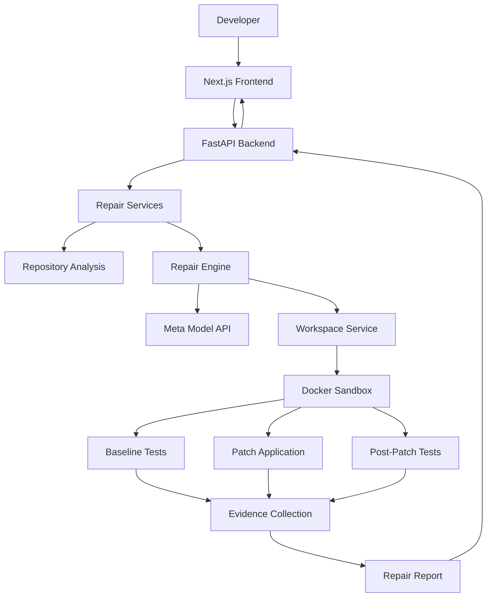

# ProofLoop

**An evidence-driven AI code repair agent that doesn't just suggest fixes, it executes tests and shows you what it fixed.**

ProofLoop investigates Python bugs, generates code patches using Meta's Model API, executes tests inside an isolated Docker environment, and produces evidence-backed repair reports.

A repair is only marked **Verified** when the required execution evidence supports the result.

---

## The Problem

AI coding assistants can generate plausible code fixes, but generating a patch does not prove that a bug has been fixed.

Developers still need to:

- Reproduce the original failure.
- Understand the affected code.
- Apply and inspect a patch.
- Run regression tests.
- Confirm that the original failure is resolved.
- Review evidence before trusting the result.

ProofLoop brings these steps together in a controlled, evidence-driven repair workflow.

## What ProofLoop Does

1. **Accepts a bug report** — Submit a bug description or upload a Python repository.
2. **Analyzes the repository** — Examines available source files and test context.
3. **Investigates the issue** — Uses Meta's Model API to help identify the cause and propose a fix.
4. **Reproduces the failure** — Executes baseline tests before applying the patch.
5. **Applies the patch** — Modifies the relevant source code in the isolated workspace.
6. **Runs regression tests** — Executes tests again after the patch.
7. **Collects evidence** — Records execution results, patch information, and integrity information.
8. **Reports the outcome** — Presents the repair status and supporting evidence.

## Key Features

- **AI-assisted bug investigation** using Meta's Model API.
- **Repository ZIP uploads** for analyzing Python projects.
- **Automated patch generation** based on bug reports and repository context.
- **Baseline failure reproduction** before patch application.
- **Docker-based test execution** with isolation and resource restrictions.
- **Post-patch regression testing** to evaluate proposed fixes.
- **Evidence-backed repair reports** with execution and patch information.
- **Repair history** for reviewing previous jobs.
- **Repair Assistant** for asking questions about completed repairs and their evidence.

## Core Principles

| Principle | Description |
|---|---|
| Evidence before verification | A generated patch alone is never sufficient to mark a repair verified. |
| Reproducibility | The original failure should be reproduced before claiming it was fixed. |
| Isolation | Repository code is executed inside a restricted Docker environment. |
| Traceability | Repair reports retain execution results and patch information. |
| Integrity | Reports undergo integrity validation. |
| Honest verification | Verification is limited to the evidence and tests actually executed. |

## Architecture



### Main Components

- **Frontend:** Provides the repair workspace, repository upload, repair sessions, history, evidence views, and Repair Assistant.
- **Backend API:** Handles requests, validation, job management, and report retrieval.
- **Repository Analysis:** Examines uploaded repository source and test files.
- **Repair Engine:** Coordinates investigation, patch generation, execution, and evidence collection.
- **Meta Model API:** Supports AI-assisted investigation and patch generation.
- **Docker Sandbox:** Executes baseline and post-patch tests in a restricted environment.
- **Evidence and Reporting:** Collects execution information and determines the resulting repair status.

## Technology Stack

| Layer | Technology |
|---|---|
| Frontend | Next.js, React, TypeScript |
| Styling | Tailwind CSS |
| Backend | Python, FastAPI |
| AI Integration | Meta Model API |
| Execution Isolation | Docker |
| Testing | Pytest |
| API Communication | REST |
| Data Validation | Pydantic |

## Project Structure

```text
proofLoop/
├── backend/
│   ├── app/
│   │   ├── agent/
│   │   ├── schemas/
│   │   ├── services/
│   │   └── main.py
│   ├── sandbox/
│   ├── tests/
│   └── requirements.txt
│
├── frontend/
│   ├── src/
│   │   ├── app/
│   │   ├── components/
│   │   └── lib/
│   └── package.json
│
├── demo-projects/
│   ├── 01-discount-calculator/
│   ├── 02-username-normalizer/
│   ├── 03-pagination/
│   └── 04-password-validator/
│
├── docs/
│   ├── architecture.md
│   └── repair-lifecycle.md
│
├── fixtures/
├── artifacts/
├── .env.example
├── README.md
└── LICENSE
```

## Getting Started

### Prerequisites

Install the following:

- Python 3.11 or later.
- Node.js and npm.
- Docker Desktop or a compatible Docker installation.
- Git.
- A Meta Model API key.

Docker must be running before executing repository repair workflows.

### 1. Clone the Repository

```bash
git clone https://github.com/WizKnight/proofLoop.git
cd proofLoop
```

### 2. Configure the Backend

Create and activate a Python virtual environment, or activate your existing Conda environment.

Install backend dependencies:

```bash
pip install -r backend/requirements.txt
```

Create your environment file from the repository root:

**Windows PowerShell**

```powershell
Copy-Item .env.example .env
```

**Linux / macOS**

```bash
cp .env.example .env
```

Configure the following variables in `.env`:

```env
MODEL_API_KEY=your_meta_api_key
MODEL_NAME=muse-spark-1.3
MODEL_API_BASE_URL=https://api.meta.ai/v1
MODEL_API_TIMEOUT_SECONDS=60
```

Keep your API key private. Never commit `.env` to the public repository.

### 3. Start the Backend

From the repository root:

```bash
python -m uvicorn backend.app.main:app --reload --host 127.0.0.1 --port 8000
```

Backend health check:

```text
http://127.0.0.1:8000/health
```

Interactive API documentation:

```text
http://127.0.0.1:8000/docs
```

### 4. Start the Frontend

Open another terminal:

```bash
cd frontend
npm install
npm run dev
```

Open the application:

```text
http://localhost:3000
```

### 5. Run Backend Tests

From the repository root:

```bash
python -m pytest backend/tests -v
```

## Using ProofLoop

### Option 1: Submit a Bug Report

Use the repair workspace to submit a bug report against the built-in controlled demonstration fixture.

ProofLoop schedules the repair workflow and returns a job ID that can be used to retrieve the execution result.

### Option 2: Upload a Python Repository

1. Prepare a ZIP archive of your Python repository.
2. Open the ProofLoop repair workspace.
3. Upload the repository.
4. Provide a clear bug description.
5. Specify the expected failing test identifier.
6. Submit the repair request.
7. Review the repair execution and evidence.
8. Inspect the generated patch and final status.

Repository uploads are subject to a 25 MiB archive size limit. The uploaded project must contain discoverable Python source files and pytest test files.

### Demo Projects

ProofLoop includes four intentionally buggy Python projects for demonstrating different classes of defects.

| Demo | Bug category | Intended behavior |
|---|---|---|
| Discount Calculator | Business logic | Correctly handles a 100% discount. |
| Username Normalizer | String processing | Removes leading and trailing whitespace. |
| Pagination | Off-by-one error | Returns the correct items for each page. |
| Password Validator | Boundary condition | Accepts passwords at the minimum permitted length. |

Each project contains its own source code, tests, README, and dependencies.

The projects are intentionally designed to fail before repair. They can be uploaded individually through the repository ZIP workflow.

## API Overview

ProofLoop exposes REST endpoints through its FastAPI backend.

| Method | Endpoint | Purpose |
|---|---|---|
| GET | `/health` | Check backend health. |
| POST | `/api/v1/repairs` | Submit a built-in fixture repair request. |
| POST | `/api/v1/repairs/repository` | Upload a repository for repair. |
| GET | `/api/v1/repairs/{job_id}` | Retrieve repair job details and report. |
| GET | `/api/v1/repairs?limit=20` | Retrieve repair history. |
| POST | `/api/v1/repairs/{job_id}/conversation` | Ask the Repair Assistant about a completed repair. |
| GET | `/api/v1/repairs/{job_id}/conversation` | Retrieve repair conversation history. |

### Submit a Repair

```http
POST /api/v1/repairs
Content-Type: application/json
```

Example request:

```json
{
  "bug_report": "Describe the bug and expected behavior."
}
```

### Upload a Repository

```http
POST /api/v1/repairs/repository
Content-Type: multipart/form-data
```

The request accepts:

- `repository` — Python repository ZIP archive.
- `bug_report` — Description of the reported issue.
- `expected_failure` — Expected failing pytest identifier.

### Retrieve a Repair

```http
GET /api/v1/repairs/{job_id}
```

### Ask the Repair Assistant

```http
POST /api/v1/repairs/{job_id}/conversation
Content-Type: application/json
```

The conversation feature is available after the repair job completes and uses the saved repair report as context.

For detailed request and response schemas, refer to the API documentation available at `/docs` when the backend is running.

## Verification Philosophy

ProofLoop distinguishes between generating a patch and verifying a repair.

The expected successful verification sequence is:

1. The baseline failure is reproduced.
2. The proposed source modification is applied.
3. Post-patch regression tests pass.
4. Required execution evidence is collected.
5. The report passes integrity validation.

A repair is only marked verified when the required evidence supports the outcome.

**A passing test suite is evidence for the tests that were actually executed. It is not a universal guarantee that every possible bug has been eliminated.**

## Security and Execution Isolation

Uploaded repository code is treated as untrusted input.

ProofLoop uses a Docker-based execution environment with restrictions designed to limit execution risks, including network access and resource consumption.

Important considerations:

- Do not upload credentials or secrets.
- Review the sandbox configuration before using untrusted repositories.
- Treat generated patches as proposals that require review.
- Do not interpret a verified repair as a guarantee of production security.

The sandbox is a security boundary that should be independently reviewed and tested before exposing the application to untrusted public traffic.

## Documentation

- [System Architecture](docs/architecture.md)
- [Repair Lifecycle and Verification](docs/repair-lifecycle.md)
- [API Reference](docs/api-reference.md)
- [Configuration Guide](docs/configuration.md)
- [Security](docs/security.md)

## Current Scope and Limitations

ProofLoop currently focuses on Python bug investigation and repair.

The MVP includes:

- Bug report submission.
- Python repository ZIP upload.
- Repository analysis.
- AI-assisted patch generation.
- Baseline failure reproduction.
- Docker-based execution.
- Post-patch regression testing.
- Evidence-backed repair reports.
- Repair session tracking and history.
- Repair Assistant with persistent conversation history.

Verification remains bounded by the repository context, tests, and execution environment available to the repair workflow.

## Future Direction

Potential areas for future development include:

- Support for additional programming languages.
- Automated regression test generation.
- More advanced repository-level debugging.
- Pull request integration.
- CI/CD integration.
- Stronger independent patch validation.
- Expanded security and execution controls.

These are future possibilities, not claims about existing functionality.

## Hackathon Project

**Built for the Meta Global AI Developer Hackathon 2026.**

ProofLoop explores a simple principle:

> A coding agent should not just tell you what it fixed. It should show you the evidence.

## License

Copyright 2026 Swapnil Jikar.

Licensed under the Apache License, Version 2.0. See [LICENSE](LICENSE) for details.

You may obtain a copy of the License at:

https://www.apache.org/licenses/LICENSE-2.0

Unless required by applicable law or agreed to in writing, software distributed under this License is distributed on an "AS IS" BASIS, WITHOUT WARRANTIES OR CONDITIONS OF ANY KIND, either express or implied.