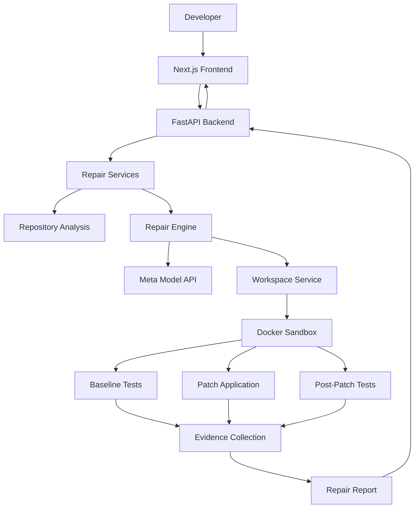

# ProofLoop

**An evidence-driven AI code repair agent that doesn't just suggest fixes — it executes tests and shows you what it fixed.**

ProofLoop investigates Python bugs, generates code patches using Meta's Model API, executes tests inside an isolated Docker environment, and produces evidence-backed repair reports.

A repair is only marked **Verified** when the required execution evidence supports the result.

---

## The Problem

AI coding assistants can generate plausible code fixes, but generating a patch does not prove that a bug has been fixed.

Developers still need to:

- Reproduce the original failure.
- Understand the affected code.
- Apply and inspect a patch.
- Run regression tests.
- Confirm that the original failure is resolved.
- Review evidence before trusting the result.

ProofLoop brings these steps together in a controlled, evidence-driven repair workflow.

## What ProofLoop Does

1. **Accepts a bug report** — Submit a bug description or upload a Python repository.
2. **Analyzes the repository** — Examines available source files and test context.
3. **Investigates the issue** — Uses Meta's Model API to help identify the cause and propose a fix.
4. **Reproduces the failure** — Executes baseline tests before applying the patch.
5. **Applies the patch** — Modifies the relevant source code in the isolated workspace.
6. **Runs regression tests** — Executes tests again after the patch.
7. **Collects evidence** — Records execution results, patch information, and integrity information.
8. **Reports the outcome** — Presents the repair status and supporting evidence.

## Key Features

- **AI-assisted bug investigation** using Meta's Model API.
- **Repository ZIP uploads** for analyzing Python projects.
- **Automated patch generation** based on bug reports and repository context.
- **Baseline failure reproduction** before patch application.
- **Docker-based test execution** with isolation and resource restrictions.
- **Post-patch regression testing** to evaluate proposed fixes.
- **Evidence-backed repair reports** with execution and patch information.
- **Repair history** for reviewing previous jobs.
- **Repair Assistant** for asking questions about completed repairs and their evidence.

## Core Principles

| Principle | Description |
|---|---|
| Evidence before verification | A generated patch alone is never sufficient to mark a repair verified. |
| Reproducibility | The original failure should be reproduced before claiming it was fixed. |
| Isolation | Repository code is executed inside a restricted Docker environment. |
| Traceability | Repair reports retain execution results and patch information. |
| Integrity | Reports undergo integrity validation. |
| Honest verification | Verification is limited to the evidence and tests actually executed. |

## Architecture



### Main Components

- **Frontend:** Provides the repair workspace, repository upload, repair sessions, history, evidence views, and Repair Assistant.
- **Backend API:** Handles requests, validation, job management, and report retrieval.
- **Repository Analysis:** Examines uploaded repository source and test files.
- **Repair Engine:** Coordinates investigation, patch generation, execution, and evidence collection.
- **Meta Model API:** Supports AI-assisted investigation and patch generation.
- **Docker Sandbox:** Executes baseline and post-patch tests in a restricted environment.
- **Evidence and Reporting:** Collects execution information and determines the resulting repair status.

## Technology Stack

| Layer | Technology |
|---|---|
| Frontend | Next.js, React, TypeScript |
| Styling | Tailwind CSS |
| Backend | Python, FastAPI |
| AI Integration | Meta Model API |
| Execution Isolation | Docker |
| Testing | Pytest |
| API Communication | REST |
| Data Validation | Pydantic |

## Project Structure

```text
proofLoop/
├── backend/
│   ├── app/
│   │   ├── agent/
│   │   ├── schemas/
│   │   ├── services/
│   │   └── main.py
│   ├── sandbox/
│   │   └── Dockerfile
│   ├── tests/
│   └── requirements.txt
│
├── frontend/
│   ├── src/
│   │   ├── app/
│   │   ├── components/
│   │   └── lib/
│   └── package.json
│
├── demo-projects/
│   ├── 01-discount-calculator/
│   ├── 02-username-normalizer/
│   ├── 03-pagination/
│   └── 04-password-validator/
│
├── docs/
│   ├── architecture.md
│   └── repair-lifecycle.md
│
├── fixtures/
├── artifacts/
├── .env.example
├── README.md
└── LICENSE
```

---

# Getting Started

You can run ProofLoop locally without accessing the hosted production backend.

The local setup requires your own Meta Model API key, a locally configured demo access code, and a working Docker installation.

## Prerequisites

Install the following:

| Requirement | Purpose |
|---|---|
| Python 3.11 or later | Backend runtime |
| Node.js and npm | Frontend runtime |
| Docker Desktop or Docker Engine | Isolated repair execution |
| Git | Repository cloning |
| Meta Model API key | AI-assisted investigation and patch generation |

**Important:** Docker must be running before executing repair workflows.

## 1. Clone the Repository

```bash
git clone https://github.com/WizKnight/proofLoop.git
cd proofLoop
```

## 2. Configure the Backend

Create a Python virtual environment.

### Windows PowerShell

```powershell
python -m venv .venv
.\.venv\Scripts\Activate.ps1
```

If PowerShell prevents activation, you can use:

```powershell
.\.venv\Scripts\activate.bat
```

### Linux / macOS

```bash
python3 -m venv .venv
source .venv/bin/activate
```

Install backend dependencies from the repository root:

```bash
python -m pip install --upgrade pip
pip install -r backend/requirements.txt
```

### Configure environment variables

Create your local environment file.

**Windows PowerShell:**

```powershell
Copy-Item .env.example .env
```

**Linux / macOS:**

```bash
cp .env.example .env
```

Open `.env` and configure the following:

```env
MODEL_API_KEY=your_meta_api_key
MODEL_NAME=muse-spark-1.3
MODEL_API_BASE_URL=https://api.meta.ai/v1
MODEL_API_TIMEOUT_SECONDS=60

PROOFLOOP_DEMO_TOKEN=your_own_local_demo_access_code
```

Replace the placeholder values with your own credentials.

### Environment variable reference

| Variable | Description |
|---|---|
| `MODEL_API_KEY` | Your Meta Model API key. |
| `MODEL_NAME` | Model identifier used by ProofLoop. |
| `MODEL_API_BASE_URL` | Meta Model API endpoint. |
| `MODEL_API_TIMEOUT_SECONDS` | API request timeout. |
| `PROOFLOOP_DEMO_TOKEN` | Your locally chosen demo access code. |

**Local authentication:** The backend protects all `/api/v1/*` endpoints using bearer-token authentication. The value of `PROOFLOOP_DEMO_TOKEN` is the access code you must enter in the ProofLoop frontend.

The local backend returns:

- `200` when the supplied access code is valid.
- `401` when the access code is missing or invalid.
- `503` when `PROOFLOOP_DEMO_TOKEN` has not been configured.

The `/health` endpoint remains publicly accessible.

**Security:** Keep `.env` private. Never commit API keys, access codes, or production credentials to GitHub.

## Activating Your Local Demo

ProofLoop uses a locally configured demo access code to protect its API.

**You do not need an invitation, an account, or the hosted demo access code to activate your local installation.** Each user creates their own local access code.

### Step 1. Generate a Local Access Code

From the repository root, run:

**Windows PowerShell:**

```powershell
python -c "import secrets; print(secrets.token_urlsafe(24))"
```

**Linux / macOS:**

```bash
python -c "import secrets; print(secrets.token_urlsafe(24))"
```

Copy the generated access code. You will use it to unlock your local ProofLoop workspace.

You can also choose your own access code.

### Step 2. Configure the Backend Access Code

Open the root `.env` file and set:

```env
PROOFLOOP_DEMO_TOKEN=paste_your_generated_access_code_here
```

Make sure the variable is not empty and that the value matches the access code you generated.

### Step 3. Start the Backend

From the repository root:

```bash
python -m uvicorn backend.app.main:app --reload --host 127.0.0.1 --port 8000 --env-file .env
```

The backend will load your local access code and use it to authenticate API requests.

### Step 4. Start the Frontend

In another terminal:

```bash
cd frontend
npm install
```

Create `frontend/.env.local` with the following configuration:

```env
NEXT_PUBLIC_API_URL=http://127.0.0.1:8000
```

Start the frontend:

```bash
npm run dev
```

### Step 5. Unlock Your Workspace

1. Open [http://localhost:3000](http://localhost:3000).
2. The ProofLoop Demo Access screen will appear.
3. Enter the access code generated in Step 1.
4. Click **Unlock workspace**.
5. ProofLoop will validate your access code against your local backend.

<badge>Workspace unlocked</badge>

You can now use your local ProofLoop installation.

### Important Notes

- The access code must match `PROOFLOOP_DEMO_TOKEN` in the root `.env` file.
- The backend and frontend must both be running.
- If you change the access code, restart the backend and use the new code when unlocking the frontend.
- Your local access code is independent of the hosted demo credentials.
- The access code is a local demo access gate, not a user account or licence key.
- You must provide your own Meta Model API key to use AI-powered repair functionality.
- Never commit your `.env` or `frontend/.env.local` files to GitHub.

**No external activation service is required.** Local demo access is validated directly by your locally running ProofLoop backend.

## 3. Build the Docker Sandbox Image

ProofLoop uses a dedicated Docker image to execute tests inside its isolated repair environment.

Make sure Docker Desktop or Docker Engine is running.

From the repository root, build the image:

```bash
docker build -t proofloop-sandbox:local -f backend/sandbox/Dockerfile .
```

The sandbox image:

- Uses Python 3.12 slim.
- Installs pytest 9.2.0.
- Disables automatic third-party pytest plugin loading.
- Uses `/workspace` as its working directory.
- Runs test execution as an unprivileged user (`65534:65534`).

Verify that the image was built:

```bash
docker image inspect proofloop-sandbox:local
```

You should see `proofloop-sandbox:local` in the output.

**Note:** Build this image before submitting repair requests. ProofLoop expects the local Docker image to be available to its repair execution workflow.

## 4. Start the Backend

From the repository root, with your Python virtual environment activated:

```bash
python -m uvicorn backend.app.main:app --reload --host 127.0.0.1 --port 8000 --env-file .env
```

The backend will be available at:

```text
http://127.0.0.1:8000
```

### Verify backend health

Open:

```text
http://127.0.0.1:8000/health
```

Expected response:

```json
{
  "status": "ok"
}
```

### Interactive API documentation

```text
http://127.0.0.1:8000/docs
```

Keep this terminal running while using the application.

## 5. Configure the Frontend

Open another terminal and navigate to the frontend directory:

```bash
cd frontend
```

Install dependencies:

```bash
npm install
```

Create the local environment file.

**Windows PowerShell:**

```powershell
Copy-Item .env.example .env.local
```

**Linux / macOS:**

```bash
cp .env.example .env.local
```

Configure `frontend/.env.local`:

```env
NEXT_PUBLIC_API_URL=http://127.0.0.1:8000
```

**Important:** Use the local backend URL above. Do not use the production Cloudflare Tunnel URL for local development.

Start the frontend:

```bash
npm run dev
```

Open:

```text
http://localhost:3000
```

## 6. Unlock the Local Workspace

When the ProofLoop Demo Access Gate appears:

1. Enter the value you configured as `PROOFLOOP_DEMO_TOKEN` in the root `.env` file.
2. Select **Unlock workspace**.
3. ProofLoop will validate the access code against your local backend.
4. Once authenticated, you can access the repair workspace.

The frontend and backend must both be running for authentication to succeed.

## 7. Run Backend Tests

From the repository root, with the virtual environment activated:

```bash
python -m pytest backend/tests -v
```

---

# Using ProofLoop

## Option 1: Submit a Bug Report

Use the repair workspace to submit a bug report against the built-in controlled demonstration fixture.

ProofLoop schedules the repair workflow and returns a job ID that can be used to retrieve the execution result.

## Option 2: Upload a Python Repository

1. Prepare a ZIP archive of your Python repository.
2. Open the ProofLoop repair workspace.
3. Upload the repository.
4. Provide a clear bug description.
5. Specify the expected failing test identifier.
6. Submit the repair request.
7. Review the repair execution and evidence.
8. Inspect the generated patch and final status.

Repository uploads are subject to a 25 MiB archive size limit. The uploaded project must contain discoverable Python source files and pytest test files.

## Demo Projects

ProofLoop includes four intentionally buggy Python projects for demonstrating different classes of defects.

| Demo | Bug category | Intended behavior |
|---|---|---|
| Discount Calculator | Business logic | Correctly handles a 100% discount. |
| Username Normalizer | String processing | Removes leading and trailing whitespace. |
| Pagination | Off-by-one error | Returns the correct items for each page. |
| Password Validator | Boundary condition | Accepts passwords at the minimum permitted length. |

Each project contains its own source code, tests, README, and dependencies.

The projects are intentionally designed to fail before repair. They can be uploaded individually through the repository ZIP workflow.

---

# API Overview

ProofLoop exposes REST endpoints through its FastAPI backend.

All `/api/v1/*` endpoints require a valid bearer token.

| Method | Endpoint | Purpose |
|---|---|---|
| GET | `/health` | Check backend health. |
| GET | `/api/v1/auth/verify` | Verify demo authentication. |
| POST | `/api/v1/repairs` | Submit a built-in fixture repair request. |
| POST | `/api/v1/repairs/repository` | Upload a repository for repair. |
| GET | `/api/v1/repairs/{job_id}` | Retrieve repair job details and report. |
| GET | `/api/v1/repairs?limit=20` | Retrieve repair history. |
| POST | `/api/v1/repairs/{job_id}/conversation` | Ask the Repair Assistant about a completed repair. |
| GET | `/api/v1/repairs/{job_id}/conversation` | Retrieve repair conversation history. |

### Submit a Repair

```http
POST /api/v1/repairs
Content-Type: application/json
Authorization: Bearer <your_local_demo_access_code>
```

Example request:

```json
{
  "bug_report": "Describe the bug and expected behavior."
}
```

### Upload a Repository

```http
POST /api/v1/repairs/repository
Content-Type: multipart/form-data
Authorization: Bearer <your_local_demo_access_code>
```

The request accepts:

- `repository` — Python repository ZIP archive.
- `bug_report` — Description of the reported issue.
- `expected_failure` — Expected failing pytest identifier.

### Retrieve a Repair

```http
GET /api/v1/repairs/{job_id}
Authorization: Bearer <your_local_demo_access_code>
```

### Ask the Repair Assistant

```http
POST /api/v1/repairs/{job_id}/conversation
Content-Type: application/json
Authorization: Bearer <your_local_demo_access_code>
```

The conversation feature is available after the repair job completes and uses the saved repair report as context.

For detailed request and response schemas, refer to the API documentation available at `/docs` when the backend is running.

---

# Hosted Demo

ProofLoop also provides a hosted demonstration environment.

**Frontend:** https://proofloop-xi.vercel.app/

The hosted application connects to the deployed backend and requires a separately distributed demo access code.

The hosted demo is intended for reviewers who want to explore ProofLoop without installing the project locally.

### Local vs Hosted Access

| | Local setup | Hosted demo |
|---|---|---|
| Frontend | `localhost:3000` | Vercel |
| Backend | `127.0.0.1:8000` | Deployed backend |
| Meta API key | Supplied by user | Configured on backend |
| Demo access code | Chosen locally | Privately distributed |
| Docker | Required locally | Configured on backend |
| Installation | Required | Not required |

Local access codes and production access codes are independent. A locally configured access code will not unlock the hosted demo.

---

# Verification Philosophy

ProofLoop distinguishes between generating a patch and verifying a repair.

The expected successful verification sequence is:

1. The baseline failure is reproduced.
2. The proposed source modification is applied.
3. Post-patch regression tests pass.
4. Required execution evidence is collected.
5. The report passes integrity validation.

A repair is only marked verified when the required evidence supports the outcome.

**A passing test suite is evidence for the tests that were actually executed. It is not a universal guarantee that every possible bug has been eliminated.**

# Security and Execution Isolation

Uploaded repository code is treated as untrusted input.

ProofLoop uses a Docker-based execution environment with restrictions designed to limit execution risks, including network access and resource consumption.

Important considerations:

- Do not upload credentials or secrets.
- Review the sandbox configuration before using untrusted repositories.
- Treat generated patches as proposals that require review.
- Do not interpret a verified repair as a guarantee of production security.
- Keep your Meta API key and demo access code private.

The sandbox is a security boundary that should be independently reviewed and tested before exposing the application to untrusted public traffic.

---

# Troubleshooting

### 1. Unable to verify the access code

Check that:

- The backend is running.
- `PROOFLOOP_DEMO_TOKEN` is configured in the root `.env`.
- The access code entered in the frontend exactly matches the configured value.
- The frontend is pointing to `http://127.0.0.1:8000`.

After changing `.env` or `.env.local`, restart the relevant service.

### 2. Backend returns 503 — Demo access is not configured

Ensure that your root `.env` contains:

```env
PROOFLOOP_DEMO_TOKEN=your_local_demo_access_code
```

Start the backend using the documented `--env-file .env` command.

### 3. Backend returns 401 — Invalid demo access code

Check that the code entered in the frontend matches the backend's `PROOFLOOP_DEMO_TOKEN`.

### 4. Docker image not found

Build the required sandbox image from the repository root:

```bash
docker build -t proofloop-sandbox:local -f backend/sandbox/Dockerfile .
```

Confirm that Docker is running and the image exists:

```bash
docker image inspect proofloop-sandbox:local
```

### 5. Frontend cannot connect to the backend

Check that:

- The backend is running on port `8000`.
- The frontend `.env.local` contains:

```env
NEXT_PUBLIC_API_URL=http://127.0.0.1:8000
```

- You restarted the frontend after changing its environment configuration.

### 6. Meta API request fails

Check that:

- `MODEL_API_KEY` is valid.
- `MODEL_NAME` is configured correctly.
- `MODEL_API_BASE_URL` is correct.
- Your Meta API account has the required access and available API credits.

### 7. Repair execution fails

Check that Docker is running, the sandbox image is available, and the backend terminal logs for the underlying execution error.

---

# Documentation

- [System Architecture](docs/architecture.md)
- [Repair Lifecycle and Verification](docs/repair-lifecycle.md)
- [API Reference](docs/api-reference.md)
- [Configuration Guide](docs/configuration.md)
- [Security](docs/security.md)

# Current Scope and Limitations

ProofLoop currently focuses on Python bug investigation and repair.

The MVP includes:

- Bug report submission.
- Python repository ZIP upload.
- Repository analysis.
- AI-assisted patch generation.
- Baseline failure reproduction.
- Docker-based execution.
- Post-patch regression testing.
- Evidence-backed repair reports.
- Repair session tracking and history.
- Repair Assistant with persistent conversation history.

Verification remains bounded by the repository context, tests, and execution environment available to the repair workflow.

# Future Direction

Potential areas for future development include:

- Support for additional programming languages.
- Automated regression test generation.
- More advanced repository-level debugging.
- Pull request integration.
- CI/CD integration.
- Stronger independent patch validation.
- Expanded security and execution controls.

These are future possibilities, not claims about existing functionality.

---

# Hackathon Project

**Built for the Meta Global AI Developer Hackathon 2026.**

ProofLoop explores a simple principle:

> A coding agent should not just tell you what it fixed. It should show you the evidence.

# License

Copyright 2026 Swapnil Jikar.

Licensed under the Apache License, Version 2.0. See [LICENSE](LICENSE) for details.

You may obtain a copy of the License at:

https://www.apache.org/licenses/LICENSE-2.0

Unless required by applicable law or agreed to in writing, software distributed under this License is distributed on an "AS IS" BASIS, WITHOUT WARRANTIES OR CONDITIONS OF ANY KIND, either express or implied.