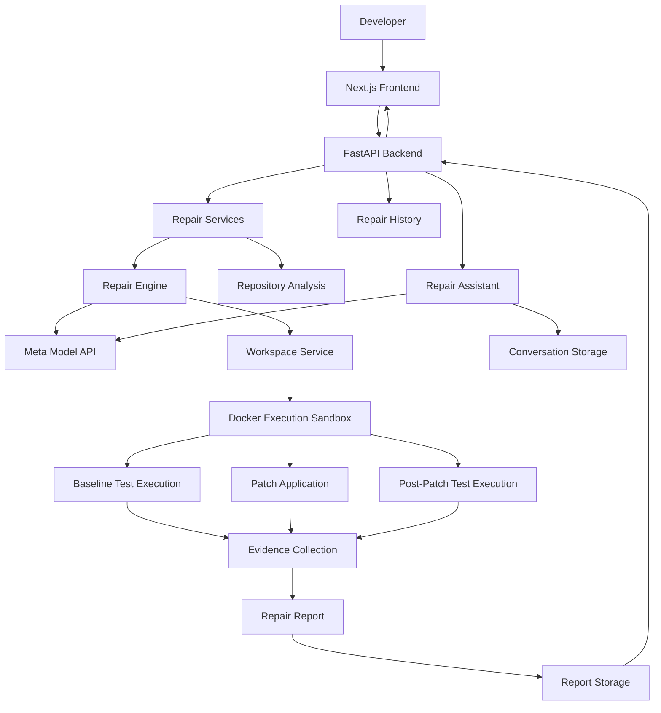
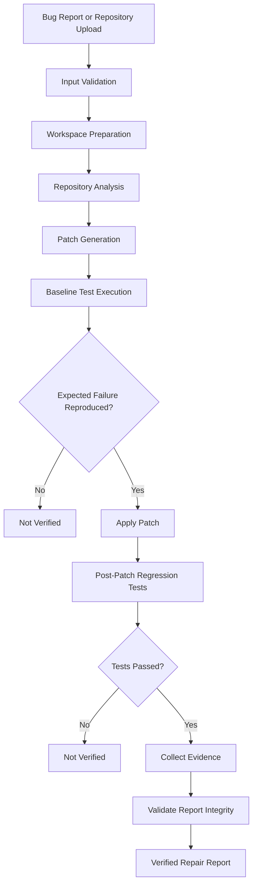

# ProofLoop - System Architecture

## 1. Overview

ProofLoop is an AI-assisted Python bug repair system built around evidence-backed execution.

Its architecture separates the user interface, API layer, repair orchestration, AI-assisted patch generation, isolated code execution, and evidence reporting.

The central design principle is that a proposed patch must be evaluated through actual execution before it can be classified as verified.

The application also provides repair history and a conversational assistant that helps developers understand completed repair results and their supporting evidence.

## 2. High-Level Architecture

## 3. Main Components

### 3.1 Frontend

**Technology:** Next.js, React, TypeScript, Tailwind CSS.

The frontend provides the developer-facing interface for interacting with ProofLoop.

Responsibilities:

- Accept bug reports and repository uploads.
- Initiate repair jobs through the backend API.
- Display repair execution status and progress.
- Present generated patches and verification evidence.
- Provide repair session and history views.
- Display completed repair reports.
- Provide the Repair Assistant interface for asking questions about repair results.

### 3.2 Backend API

**Technology:** Python and FastAPI.

The backend acts as the central interface between the frontend and repair services.

Responsibilities:

- Expose repair submission and retrieval endpoints.
- Validate incoming requests.
- Accept and validate repository ZIP uploads.
- Schedule repair jobs.
- Coordinate repair execution.
- Persist repair job information and reports.
- Handle repair conversation requests.
- Return job status and report information.

Repair jobs are executed through FastAPI background tasks, with job information persisted by the report storage service.

### 3.3 Repository Analysis

The repository analysis layer examines uploaded projects to identify relevant source code and testing context.

Responsibilities include:

- Inspecting repository files.
- Identifying Python source files.
- Discovering available pytest test files.
- Preparing repository context for the repair engine.

Repository analysis is performed before the uploaded project enters the execution workflow.

### 3.4 Repair Engine

The repair engine coordinates the bug repair lifecycle.

Its responsibilities include:

- Processing the bug report.
- Using repository context to investigate the issue.
- Requesting a proposed patch from the Meta Model API.
- Coordinating baseline test execution.
- Managing patch application.
- Coordinating post-patch regression testing.
- Collecting execution evidence.
- Determining the resulting repair status.

The repair engine is responsible for connecting AI-generated changes with actual execution results.

### 3.5 Meta Model API Integration

ProofLoop uses Meta's Model API for AI-assisted bug investigation and patch generation.

The model receives relevant bug and repository context and proposes a code change.

Model output is treated as a proposed solution rather than proof of correctness.

The Repair Assistant also uses the model to answer questions using the completed repair report and available conversation context.

### 3.6 Workspace and Docker Sandbox

Repository execution is handled through a workspace and Docker-based execution environment.

Uploaded repository code is treated as untrusted input.

The sandbox configuration is designed to restrict execution risks through controls such as:

- Disabled network access.
- Read-only filesystem configuration.
- Non-root execution.
- Resource restrictions.
- Execution timeouts.
- Bounded command output.

The sandbox is used to:

1. Execute baseline tests.
2. Apply the generated patch.
3. Execute post-patch regression tests.
4. Capture execution results.

### 3.7 Evidence and Reporting

The evidence layer collects information from the repair workflow.

The resulting report provides information about:

- Baseline test execution.
- Execution exit codes.
- Patch changes.
- Source integrity information.
- Post-patch test execution.
- Verification status.
- Report integrity.

The report is validated against the repair report schema before being persisted.

A verified result requires the evidence conditions defined by the verification model.

### 3.8 Report Storage and Repair History

Repair job information and generated reports are persisted through the report storage service.

The history API retrieves saved jobs and independently validates stored repair reports before exposing their report status.

This allows developers to revisit previous repair sessions and inspect their outcomes.

### 3.9 Repair Assistant

The Repair Assistant provides a conversational interface for understanding completed repairs.

It uses the saved repair report and conversation history as context.

Responsibilities include:

- Explaining repair outcomes.
- Answering questions about execution evidence.
- Explaining generated patches.
- Clarifying verification status.
- Maintaining conversation history for each repair session.

The assistant is intended to explain repair results; it does not independently modify repository source code.

## 4. Repair Lifecycle

## 5. Verification Model

ProofLoop distinguishes three important concepts:

| Concept | Meaning |
|---|---|
| Patch generated | The AI proposed a code change. |
| Tests passed | The executed post-patch tests completed successfully. |
| Repair verified | The required execution evidence supports the repair result and the report passes integrity validation. |

The expected successful verification sequence requires:

1. Reproduction of the expected baseline failure.
2. Successful patch application and source modification.
3. Successful post-patch regression testing.
4. Collection of required execution evidence.
5. Successful report integrity validation.

A generated patch must never automatically be considered a verified repair.

The verification result is based on evidence available from the actual execution workflow.

## 6. API Layer

The frontend communicates with the backend through REST endpoints.

| Method | Endpoint | Description |
|---|---|---|
| GET | `/health` | Service health |
| POST | `/api/v1/repairs` | Submit a built-in fixture repair request |
| POST | `/api/v1/repairs/repository` | Upload a repository archive for repair |
| GET | `/api/v1/repairs/{job_id}` | Retrieve a repair job |
| GET | `/api/v1/repairs?limit=...` | Retrieve repair history |
| POST | `/api/v1/repairs/{job_id}/conversation` | Send a message to the Repair Assistant |
| GET | `/api/v1/repairs/{job_id}/conversation` | Retrieve repair conversation history |

The API also provides interactive documentation through FastAPI's OpenAPI interface.

## 7. Data and Persistence

ProofLoop uses file-based JSON persistence for repair job information and generated reports.

Repair conversations are stored separately from the main repair report.

The persistence layer supports:

- Repair job state.
- Creation and update timestamps.
- Generated repair reports.
- Error information.
- Repair conversation history.

This storage approach supports the current MVP. A production deployment with multiple backend instances would require a shared persistent storage strategy.

## 8. Design Principles

### Evidence-driven decisions

Repair status is determined by execution evidence rather than model confidence or generated explanations.

### Separation of responsibilities

The frontend, backend API, repair engine, model integration, execution environment, and reporting layer have distinct responsibilities.

### Execution isolation

Uploaded repository code is treated as untrusted input and executed in a restricted Docker environment.

### Traceability

Repair reports retain information about the changes and execution results used to evaluate a repair.

### Honest verification

A passing test suite supports only the tests that were actually executed. It does not establish that every possible defect has been eliminated.

### Explainability

Developers should be able to inspect the repair outcome and ask questions about the evidence supporting it.

## 9. Current Scope

The current MVP focuses on Python repository repair.

It demonstrates the integration of:

- AI-assisted code investigation.
- Automated patch generation.
- Repository ZIP uploads.
- Baseline failure reproduction.
- Isolated test execution.
- Regression validation.
- Evidence-backed reporting.
- Repair history.
- Evidence-aware repair conversations.

Future capabilities should build on this execution-and-evidence foundation rather than replace it.