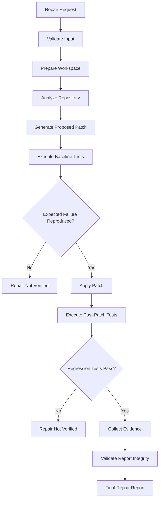

# ProofLoop - Repair Lifecycle & Verification

## 1. Purpose

ProofLoop is designed to distinguish between an AI-generated code suggestion and a repair supported by execution evidence.

The repair lifecycle coordinates repository analysis, patch generation, baseline execution, patch application, regression testing, and evidence reporting.

The system must not classify a repair as verified merely because the AI generated a plausible patch.

## 2. End-to-End Lifecycle



## 3. Stage Details

### Stage 1 — Request Submission

A developer submits either:

- A bug report through the built-in repair workspace.
- A Python repository archive accompanied by a bug report and expected-failure identifier.

The backend validates the request before initiating the repair workflow.

For repository uploads, the backend:

- Reads the uploaded archive.
- Enforces the configured archive size limit.
- Extracts the archive into a temporary workspace.
- Analyzes the repository.
- Checks for discoverable Python source files and pytest test files.

Invalid uploads are rejected before a repair job is scheduled.

### Stage 2 — Job Creation and Workspace Preparation

After successful validation, the backend creates a repair job.

The job initially enters the `queued` state.

The backend persists the job information before scheduling its background execution.

When execution begins, the job transitions to `running`.

For uploaded repositories, the temporary workspace provides the context for:

- Inspecting repository files.
- Identifying relevant source code and tests.
- Applying the generated patch.
- Capturing source changes.

Repository execution is delegated to the isolated Docker environment.

### Stage 3 — Repository Analysis

The analysis layer examines the available repository context to support bug investigation.

The goal is to identify the source files and test context relevant to the reported issue.

Repository analysis also checks whether the uploaded project contains usable Python source files and discoverable pytest tests.

### Stage 4 — AI-Assisted Patch Generation

ProofLoop communicates with Meta's Model API to generate a proposed fix.

The model receives relevant bug and repository context and returns a proposed code change.

Important distinction:

**A model-generated patch is a proposal, not a verified solution.**

The patch must proceed through the execution workflow before a successful repair can be reported.

### Stage 5 — Baseline Execution

Before applying the proposed patch, ProofLoop executes the relevant baseline tests.

This stage establishes whether the reported failure can be reproduced.

The baseline execution result is captured as evidence.

The expected failure must be observed for the repair to establish that it has addressed the reported issue.

If the expected failure cannot be established, the system must not claim that the patch fixed that failure.

### Stage 6 — Patch Application

Once the baseline failure is established, the proposed patch is applied to the working repository.

The system records information about the source changes.

Patch application and source modification are important parts of the verification evidence.

### Stage 7 — Post-Patch Regression Testing

ProofLoop executes the relevant tests again after applying the patch.

The purpose is to determine whether:

- The original failure is resolved.
- The executed regression tests pass.
- The patch introduces an observed test failure.

A successful post-patch test run is evidence about the tests that were actually executed, not proof that every possible defect has been eliminated.

### Stage 8 — Evidence Collection

The repair workflow collects execution and patch information needed to evaluate the result.

Evidence can include:

- Baseline test results.
- Baseline execution exit code.
- Post-patch test results.
- Post-patch execution exit code.
- Patch information and diff.
- Source integrity information.
- Execution identifiers.
- Verification scope.

The collected evidence provides the basis for the resulting repair report.

### Stage 9 — Report Integrity Validation

The generated report undergoes integrity validation.

The integrity result is distinct from the repair verification result:

- **Valid integrity** means the report passed its integrity checks.
- **Verified repair** means the required execution evidence supports the repair outcome.

A valid report does not automatically mean a repair is verified.

The repair report must satisfy its schema and verification requirements before it can be treated as a verified result.

### Stage 10 — Final Repair Status

The backend produces a repair report containing the resulting status and available evidence.

The completed repair job is persisted and made available through the repair API.

The frontend presents the repair outcome through the repair session.

The Repair Assistant can then answer questions using the completed repair report and saved conversation context.

## 4. Verification Conditions

The central verification principle is:

> ProofLoop does not trust a generated patch. It evaluates the patch through execution evidence.

The expected successful sequence is:

| Check | Expected evidence |
|---|---|
| Baseline execution | Expected failure reproduced |
| Patch application | Source code successfully modified |
| Post-patch execution | Relevant regression tests pass |
| Execution traceability | Required execution information recorded |
| Report validation | Integrity checks pass |

When these conditions are satisfied, the repair can be classified as verified according to the implemented workflow.

If a required condition is missing or fails, the repair must not be presented as verified.

## 5. Example: Discount Calculation Bug

Consider the discount calculation fixture included with ProofLoop.

The function incorrectly returns the original price when the discount is 100%.

### Original implementation

```python
def calculate_discount(price: float, discount_percent: float) -> float:
    if discount_percent < 0 or discount_percent > 100:
        raise ValueError("discount_percent must be between 0 and 100")

    if discount_percent == 100:
        return price

    return price * (1 - discount_percent / 100)
```

### Expected behavior

```python
calculate_discount(100, 100) == 0
```

### Baseline test

The test is executed against the original implementation.

Expected result:

```text
FAILED
```

The failure demonstrates that the reported behavior can be reproduced.

### Proposed patch

```python
def calculate_discount(price: float, discount_percent: float) -> float:
    if discount_percent < 0 or discount_percent > 100:
        raise ValueError("discount_percent must be between 0 and 100")

    if discount_percent == 100:
        return 0

    return price * (1 - discount_percent / 100)
```

### Post-patch test

The regression test is executed again.

Expected result:

```text
PASSED
```

### Result

The repair report can record:

- The reproduced baseline failure.
- The applied source change.
- The successful post-patch test execution.
- The execution evidence.
- The report integrity result.
- The resulting verification status.

This demonstrates the difference between suggesting a fix and validating its behavior through execution.

## 6. Job States and Failure Outcomes

ProofLoop maintains a repair job lifecycle independently of the repair verification result.

The job state describes execution progress.

| Job state | Meaning |
|---|---|
| `queued` | The repair job has been created and is waiting for execution. |
| `running` | The repair workflow is executing. |
| `completed` | The repair workflow finished and its report was persisted. |
| `failed` | The repair job could not be completed. |

A completed job does not necessarily mean a verified repair. A completed job can contain an unsuccessful or unverified repair report.

Examples of repair outcomes include:

| Situation | Appropriate outcome |
|---|---|
| Model cannot generate a usable patch | Repair unsuccessful |
| Baseline failure cannot be reproduced | Not verified |
| Patch application fails | Not verified |
| Post-patch tests fail | Not verified |
| Required evidence is missing | Not verified |
| Report integrity validation fails | Invalid report |
| Required evidence and integrity checks pass | Verified, subject to executed test scope |

The precise repair status is determined by the backend report validation and verification logic.

## 7. Report Integrity vs. Repair Verification

These concepts serve different purposes.

### Report Integrity

Determines whether the report satisfies its validation and integrity requirements.

### Repair Verification

Determines whether the collected execution evidence supports the repair result.

A report can be structurally valid while describing an unsuccessful repair.

Likewise, a generated patch can look correct without having sufficient execution evidence to support verification.

ProofLoop keeps these concepts separate to avoid overstating the result.

## 8. Repair Assistant

After a repair job completes, developers can use the Repair Assistant to ask questions about the repair.

The assistant uses the saved repair report and conversation history as context.

Example questions include:

- What caused the original test failure?
- What did the generated patch change?
- Why was this repair marked verified?
- Which tests were executed?
- What limitations remain in the verification evidence?

Conversation history is persisted separately for each repair job.

The Repair Assistant explains the available repair evidence; it does not independently apply additional source-code modifications.

## 9. Why This Matters

AI-generated code can look correct while still containing defects.

ProofLoop introduces an execution-based evaluation layer between patch generation and the final repair claim.

This creates a more transparent workflow in which developers can inspect:

- What failed before the patch.
- What changed.
- What happened after the patch.
- What evidence supports the final status.
- What limitations remain.

## 10. Limitations

ProofLoop's verification is bounded by the tests and execution context available to it.

A verified repair does not guarantee:

- The absence of every possible bug.
- Complete correctness across all production environments.
- Security against every possible attack.
- Compatibility with untested configurations.
- Correctness beyond the scope of executed tests.

The objective is not to claim perfect code. It is to make repair outcomes more transparent, testable, and evidence-backed.